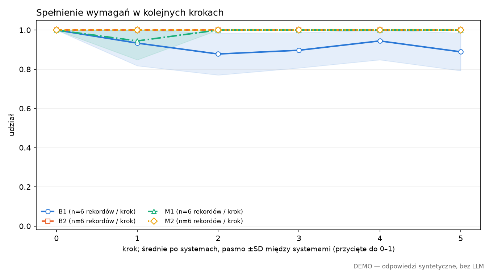
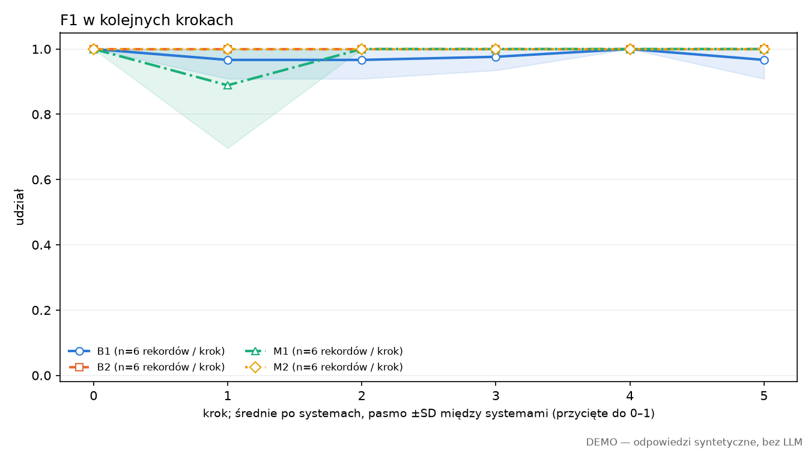
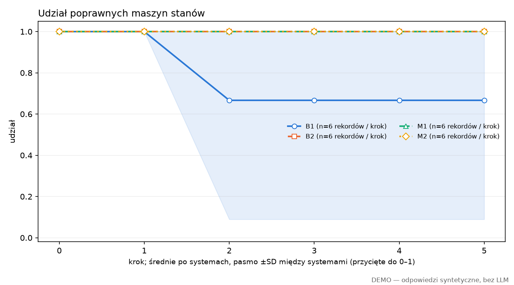
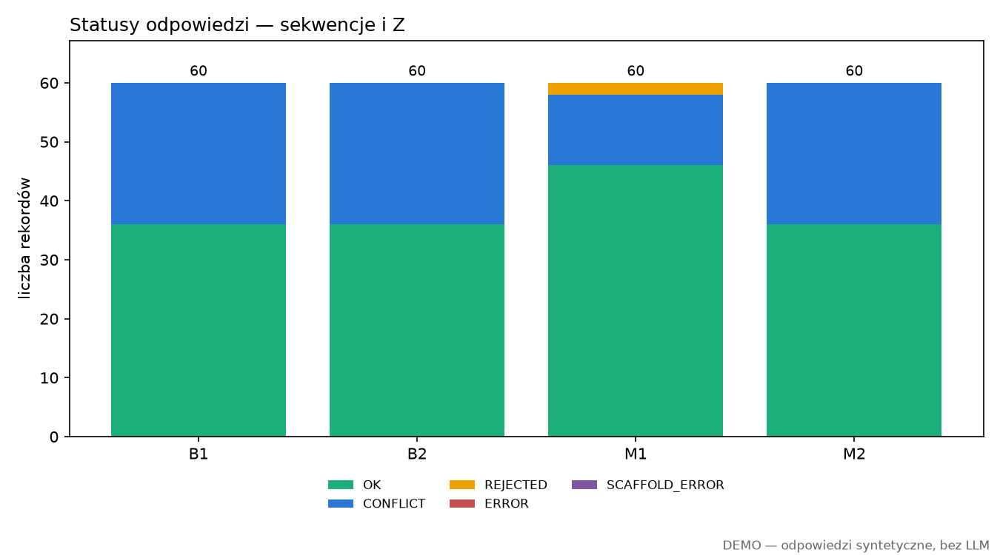
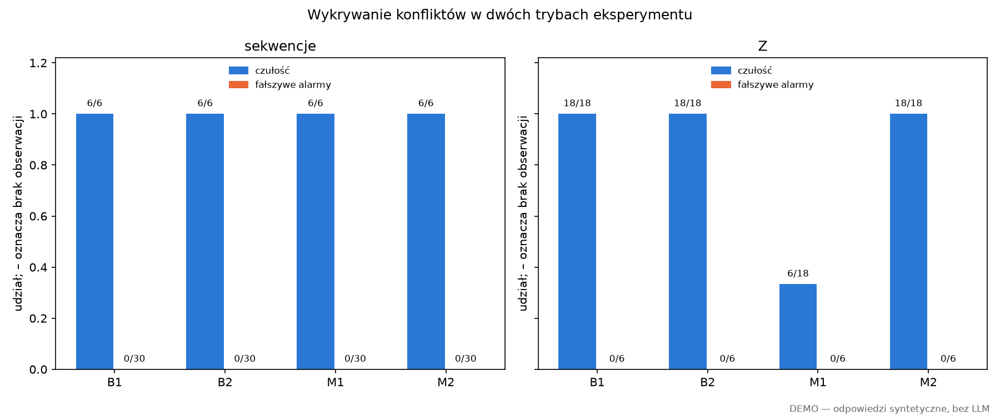
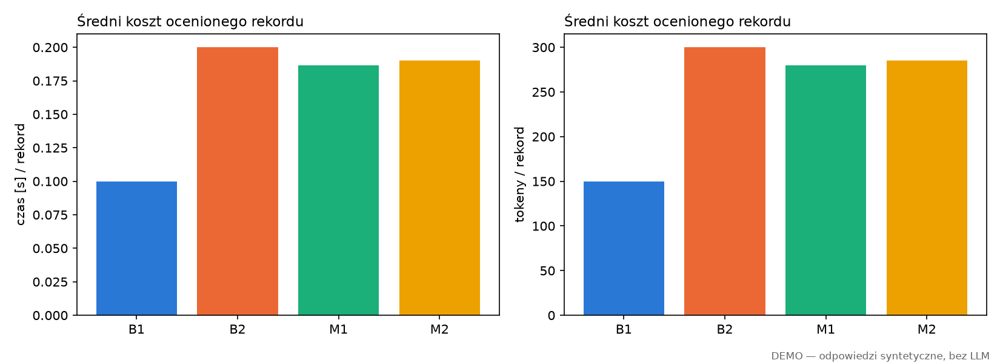

# Raport: demo_mock

Model: `MOCK_DEMO_OFFLINE` (digest `000000000000`), temperatura 0.2.

Dane: `data/pilot`; systemy: 3; planowane powtórzenia: 2; zapisane powtórzenia: 2; zapisane kroki: 0, 1, 2, 3, 4, 5.

**Status: PILOTAŻ; KOMPLETNY.**

**DEMONSTRACJA OFFLINE — zaplanowane odpowiedzi; to nie są wyniki rzeczywistego LLM.**

## Kompletność

| część | oczekiwane | zapisane | brakujące | nadmiarowe |
|---|---|---|---|---|
| sekwencje | 144 | 144 | 0 | 0 |
| Z | 96 | 96 | 0 | 0 |

Zapisane rekordy po deduplikacji; przy powtórzonym kluczu obowiązuje ostatni zapis.

Metryka główna to surowy odsetek testów wymagań. Wysoki wynik może współistnieć z niepoprawną maszyną. Poprawność maszyny raportujemy osobno; nieosiągalne stany są ostrzeżeniem. W pełni poprawny model musi być poprawną maszyną i spełniać W ⊆ T ⊆ W ∪ P.

Analiza wyłącznie eksploracyjna. Testy potwierdzające wymagają kompletnego przebiegu co najmniej 10 systemów, czterech wariantów B1/B2/M1/M2 i sześciu kroków, z wersjonowanym manifestem, poza datasetem pilotażowym.

## Część eksploracyjna

### Średnie metryk (dostępne kroki 1–5)

Każda komórka podaje średnią i liczbę niepustych obserwacji n.

| metryka | B1 | B2 | M1 | M2 |
|---|---|---|---|---|
| spełnienie wymagań | 0.908 (n=30) | 1.000 (n=30) | 0.989 (n=30) | 1.000 (n=30) |
| precyzja | 1.000 (n=30) | 1.000 (n=30) | 0.978 (n=30) | 1.000 (n=30) |
| czułość | 0.958 (n=30) | 1.000 (n=30) | 0.978 (n=30) | 1.000 (n=30) |
| F1 | 0.975 (n=30) | 1.000 (n=30) | 0.978 (n=30) | 1.000 (n=30) |
| w pełni poprawny | 0.600 (n=30) | 1.000 (n=30) | 0.933 (n=30) | 1.000 (n=30) |
| poprawna maszyna stanów | 0.733 (n=30) | 1.000 (n=30) | 1.000 (n=30) | 1.000 (n=30) |
| błędy walidacji maszyny | 0.533 (n=30) | 0.000 (n=30) | 0.000 (n=30) | 0.000 (n=30) |
| pokrycie dodań | 0.944 (n=18) | 1.000 (n=18) | 0.889 (n=18) | 1.000 (n=18) |
| regresje funkcjonalne | 0.167 (n=30) | 0.000 (n=30) | 0.000 (n=30) | 0.000 (n=30) |
| regresje strukturalne | 0.033 (n=30) | 0.000 (n=30) | 0.000 (n=30) | 0.000 (n=30) |
| halucynacje | 0.000 (n=30) | 0.000 (n=30) | 0.067 (n=30) | 0.000 (n=30) |
| zmiany zbędne | 0.067 (n=30) | 0.000 (n=30) | 0.133 (n=30) | 0.000 (n=30) |
| problemy modelu | 0.933 (n=30) | 0.000 (n=30) | 0.000 (n=30) | 0.000 (n=30) |
| zgłoszony konflikt | 0.200 (n=30) | 0.200 (n=30) | 0.200 (n=30) | 0.200 (n=30) |
| wywołania LLM | 1.000 (n=30) | 2.000 (n=30) | 1.733 (n=30) | 1.800 (n=30) |
| ponowienia | 0.000 (n=30) | 0.000 (n=30) | 0.000 (n=30) | 0.000 (n=30) |
| tokeny | 150.000 (n=30) | 300.000 (n=30) | 260.000 (n=30) | 270.000 (n=30) |
| czas [s] | 0.100 (n=30) | 0.200 (n=30) | 0.173 (n=30) | 0.180 (n=30) |
| pokrycie usunięć | 1.000 (n=18) | 1.000 (n=18) | 0.889 (n=18) | 1.000 (n=18) |
| krok konfliktowy poprawny | 1.000 (n=6) | 1.000 (n=6) | 1.000 (n=6) | 1.000 (n=6) |
| zgodność listy konfliktu | 1.000 (n=6) | 1.000 (n=6) | 1.000 (n=6) | 1.000 (n=6) |
| halucynacje ścisłe | – (n=0) | – (n=0) | 0.067 (n=30) | 0.000 (n=30) |
| błędy uzasadnione scaffoldem | – (n=0) | – (n=0) | 0.000 (n=30) | 0.000 (n=30) |
| decyzje bez uzasadnienia | – (n=0) | – (n=0) | 1.000 (n=30) | 1.000 (n=30) |
| konflikty wykryte przez skrypt | – (n=0) | – (n=0) | 0.200 (n=30) | 0.200 (n=30) |
| zmiana zablokowana przez skrypt | – (n=0) | – (n=0) | 0.267 (n=30) | 0.200 (n=30) |
| diff odrzucony | – (n=0) | – (n=0) | 0.067 (n=30) | 0.000 (n=30) |
| zmiany zbędne poza strefą wpływu | – (n=0) | – (n=0) | – (n=0) | 0.000 (n=24) |

### Krok 0

| wariant | spełnienie wymagań | F1 | poprawna maszyna | w pełni poprawny |
|---|---|---|---|---|
| B1 | 1.000 (n=6) | 1.000 (n=6) | 1.000 (n=6) | 1.000 (n=6) |
| B2 | 1.000 (n=6) | 1.000 (n=6) | 1.000 (n=6) | 1.000 (n=6) |
| M1 | 1.000 (n=6) | 1.000 (n=6) | 1.000 (n=6) | 1.000 (n=6) |
| M2 | 1.000 (n=6) | 1.000 (n=6) | 1.000 (n=6) | 1.000 (n=6) |

### Według typu zmiany — spełnienie wymagań

| typ zmiany | B1 | B2 | M1 | M2 |
|---|---|---|---|---|
| sprzeczność | 0.878 (n=6) | 1.000 (n=6) | 1.000 (n=6) | 1.000 (n=6) |
| nowa zależność | 1.000 (n=6) | 1.000 (n=6) | 0.944 (n=6) | 1.000 (n=6) |
| nowa reguła | 0.897 (n=6) | 1.000 (n=6) | 1.000 (n=6) | 1.000 (n=6) |
| usunięcie | 0.889 (n=6) | 1.000 (n=6) | 1.000 (n=6) | 1.000 (n=6) |
| zmiana przejścia | 0.878 (n=6) | 1.000 (n=6) | 1.000 (n=6) | 1.000 (n=6) |

### Powtarzalność

Odchylenie standardowe metryki głównej między powtórzeniami, średnia po systemach.

| wariant | odch. std. |
|---|---|
| B1 | 0.069 (n=3) |
| B2 | 0.000 (n=3) |
| M1 | 0.000 (n=3) |
| M2 | 0.000 (n=3) |

## Statusy odpowiedzi

| wariant | OK | CONFLICT | REJECTED | ERROR | SCAFFOLD_ERROR |
|---|---|---|---|---|---|
| B1 | 36 | 24 | 0 | 0 | 0 |
| B2 | 36 | 24 | 0 | 0 | 0 |
| M1 | 46 | 12 | 2 | 0 | 0 |
| M2 | 36 | 24 | 0 | 0 | 0 |

## Wykrywanie konfliktów

Sekwencje i Z są oceniane osobno. CONFLICT na przypadku bez konfliktu oznacza fałszywy alarm. ERROR, REJECTED i SCAFFOLD_ERROR na konflikcie liczą się jako niewykrycie.

| część | wariant | rodzaj | zgłoszenia / przypadki | udział |
|---|---|---|---|---|
| sekwencje | B1 | łącznie | 6/6 | 1.000 |
| sekwencje | B1 | stanowy | 6/6 | 1.000 |
| sekwencje | B1 | przechodni | 0/0 | – |
| sekwencje | B1 | kolejności | 0/0 | – |
| sekwencje | B1 | bez konfliktu | 0/30 | 0.000 |
| sekwencje | B2 | łącznie | 6/6 | 1.000 |
| sekwencje | B2 | stanowy | 6/6 | 1.000 |
| sekwencje | B2 | przechodni | 0/0 | – |
| sekwencje | B2 | kolejności | 0/0 | – |
| sekwencje | B2 | bez konfliktu | 0/30 | 0.000 |
| sekwencje | M1 | łącznie | 6/6 | 1.000 |
| sekwencje | M1 | stanowy | 6/6 | 1.000 |
| sekwencje | M1 | przechodni | 0/0 | – |
| sekwencje | M1 | kolejności | 0/0 | – |
| sekwencje | M1 | bez konfliktu | 0/30 | 0.000 |
| sekwencje | M2 | łącznie | 6/6 | 1.000 |
| sekwencje | M2 | stanowy | 6/6 | 1.000 |
| sekwencje | M2 | przechodni | 0/0 | – |
| sekwencje | M2 | kolejności | 0/0 | – |
| sekwencje | M2 | bez konfliktu | 0/30 | 0.000 |
| Z | B1 | łącznie | 18/18 | 1.000 |
| Z | B1 | stanowy | 6/6 | 1.000 |
| Z | B1 | przechodni | 6/6 | 1.000 |
| Z | B1 | kolejności | 6/6 | 1.000 |
| Z | B1 | bez konfliktu | 0/6 | 0.000 |
| Z | B2 | łącznie | 18/18 | 1.000 |
| Z | B2 | stanowy | 6/6 | 1.000 |
| Z | B2 | przechodni | 6/6 | 1.000 |
| Z | B2 | kolejności | 6/6 | 1.000 |
| Z | B2 | bez konfliktu | 0/6 | 0.000 |
| Z | M1 | łącznie | 6/18 | 0.333 |
| Z | M1 | stanowy | 6/6 | 1.000 |
| Z | M1 | przechodni | 0/6 | 0.000 |
| Z | M1 | kolejności | 0/6 | 0.000 |
| Z | M1 | bez konfliktu | 0/6 | 0.000 |
| Z | M2 | łącznie | 18/18 | 1.000 |
| Z | M2 | stanowy | 6/6 | 1.000 |
| Z | M2 | przechodni | 6/6 | 1.000 |
| Z | M2 | kolejności | 6/6 | 1.000 |
| Z | M2 | bez konfliktu | 0/6 | 0.000 |

## Koszt

Koszt deduplikowanych rekordów obejmuje ponowienia odpowiedzi, ale nie wszystkie wcześniejsze próby zastąpione przy wznowieniu ani przerwane wywołania bez rekordu.

| wariant | rekordy | wywołania | ponowienia | tokeny | czas [s] | tokeny / rekord | s / rekord |
|---|---|---|---|---|---|---|---|
| B1 | 60 | 60 | 0 | 9000 | 6.000 | 150.000 | 0.100 |
| B2 | 60 | 120 | 0 | 18000 | 12.000 | 300.000 | 0.200 |
| M1 | 60 | 112 | 0 | 16800 | 11.200 | 280.000 | 0.187 |
| M2 | 60 | 114 | 0 | 17100 | 11.400 | 285.000 | 0.190 |

