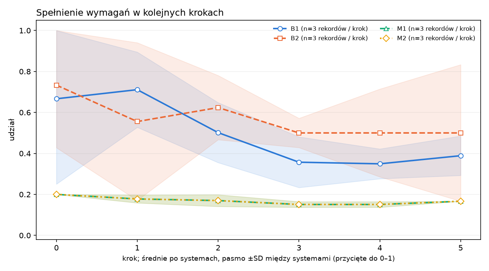
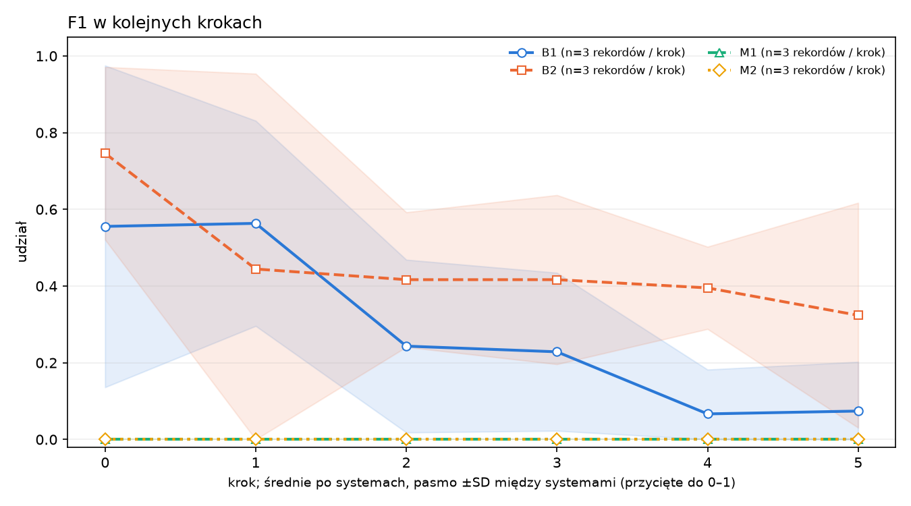
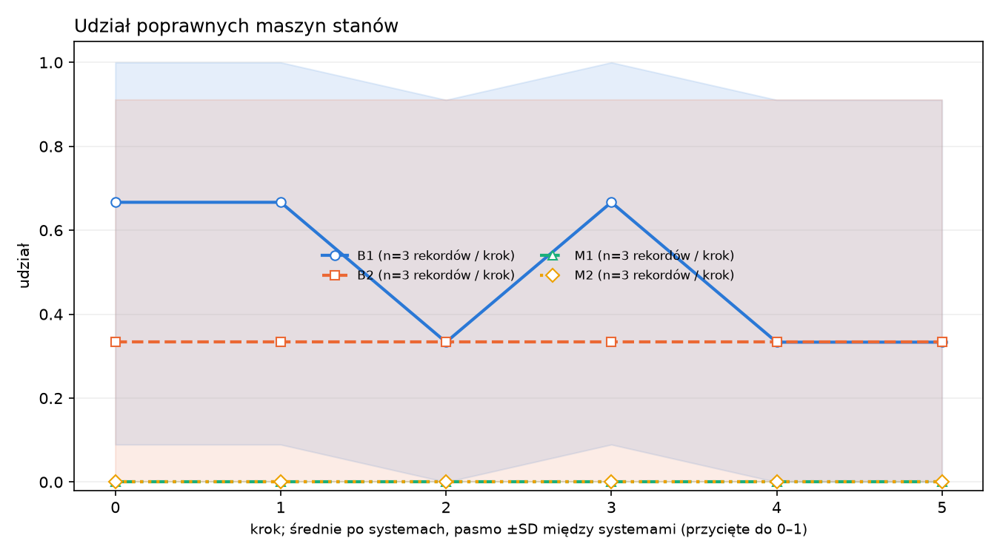
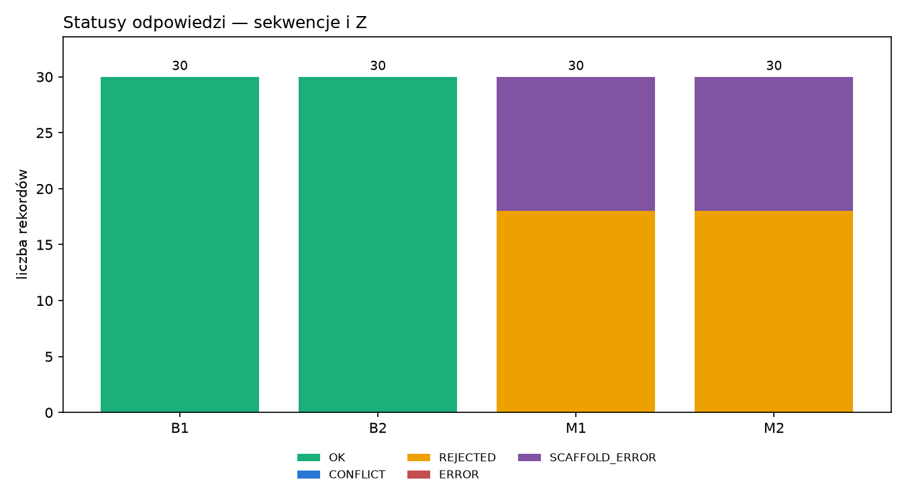
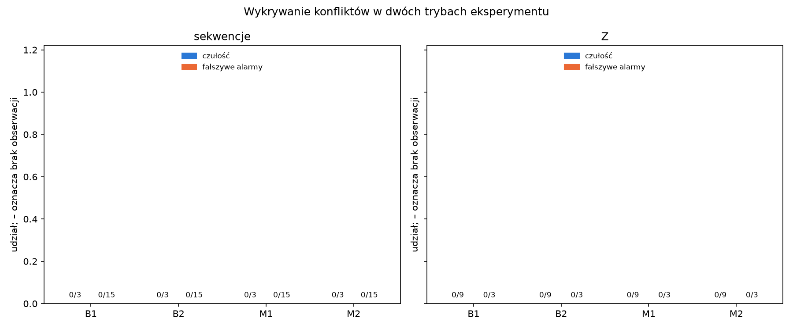
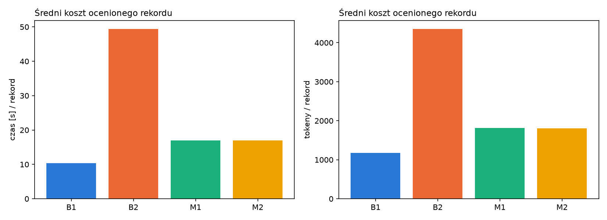

# Raport: pilot_pelny_01

Model: `phi3:mini` (digest `4f2222927938`), temperatura 0.2.

Dane: `data/pilot`; systemy: 3; planowane powtórzenia: 1; zapisane powtórzenia: 1; zapisane kroki: 0, 1, 2, 3, 4, 5.

**Status: PILOTAŻ; KOMPLETNY.**

## Kompletność

| część | oczekiwane | zapisane | brakujące | nadmiarowe |
|---|---|---|---|---|
| sekwencje | 72 | 72 | 0 | 0 |
| Z | 48 | 48 | 0 | 0 |

Zapisane rekordy po deduplikacji; przy powtórzonym kluczu obowiązuje ostatni zapis.

Metryka główna to surowy odsetek testów wymagań. Wysoki wynik może współistnieć z niepoprawną maszyną. Poprawność maszyny raportujemy osobno; nieosiągalne stany są ostrzeżeniem. W pełni poprawny model musi być poprawną maszyną i spełniać W ⊆ T ⊆ W ∪ P.

Analiza wyłącznie eksploracyjna. Testy potwierdzające wymagają kompletnego przebiegu co najmniej 10 systemów, czterech wariantów B1/B2/M1/M2 i sześciu kroków, z wersjonowanym manifestem, poza datasetem pilotażowym.

## Część eksploracyjna

### Średnie metryk (dostępne kroki 1–5)

Każda komórka podaje średnią i liczbę niepustych obserwacji n.

| metryka | B1 | B2 | M1 | M2 |
|---|---|---|---|---|
| spełnienie wymagań | 0.462 (n=15) | 0.536 (n=15) | 0.163 (n=15) | 0.163 (n=15) |
| precyzja | 0.227 (n=15) | 0.451 (n=15) | – (n=0) | – (n=0) |
| czułość | 0.267 (n=15) | 0.394 (n=15) | 0.000 (n=15) | 0.000 (n=15) |
| F1 | 0.235 (n=15) | 0.399 (n=15) | 0.000 (n=15) | 0.000 (n=15) |
| w pełni poprawny | 0.000 (n=15) | 0.000 (n=15) | 0.000 (n=15) | 0.000 (n=15) |
| poprawna maszyna stanów | 0.467 (n=15) | 0.333 (n=15) | 0.000 (n=15) | 0.000 (n=15) |
| błędy walidacji maszyny | 0.533 (n=15) | 1.467 (n=15) | 1.000 (n=15) | 1.000 (n=15) |
| pokrycie dodań | 0.000 (n=9) | 0.444 (n=9) | 0.000 (n=9) | 0.000 (n=9) |
| regresje funkcjonalne | 0.400 (n=15) | 0.533 (n=15) | 0.000 (n=15) | 0.000 (n=15) |
| regresje strukturalne | 0.533 (n=15) | 0.733 (n=15) | 0.000 (n=15) | 0.000 (n=15) |
| halucynacje | 2.867 (n=15) | 1.733 (n=15) | 0.000 (n=15) | 0.000 (n=15) |
| zmiany zbędne | 1.400 (n=15) | 1.133 (n=15) | 0.000 (n=15) | 0.000 (n=15) |
| problemy modelu | 1.200 (n=15) | 2.267 (n=15) | 1.000 (n=15) | 1.000 (n=15) |
| zgłoszony konflikt | 0.000 (n=15) | 0.000 (n=15) | 0.000 (n=15) | 0.000 (n=15) |
| wywołania LLM | 1.000 (n=15) | 2.000 (n=15) | 1.000 (n=15) | 1.067 (n=15) |
| ponowienia | 0.000 (n=15) | 0.000 (n=15) | 0.000 (n=15) | 0.067 (n=15) |
| tokeny | 1215.267 (n=15) | 5430.600 (n=15) | 1759.133 (n=15) | 2019.467 (n=15) |
| czas [s] | 8.932 (n=15) | 66.234 (n=15) | 14.398 (n=15) | 22.628 (n=15) |
| pokrycie usunięć | 0.556 (n=9) | 0.556 (n=9) | 1.000 (n=9) | 1.000 (n=9) |
| krok konfliktowy poprawny | 0.000 (n=3) | 0.000 (n=3) | 0.000 (n=3) | 0.000 (n=3) |
| halucynacje ścisłe | – (n=0) | – (n=0) | 0.000 (n=15) | 0.000 (n=15) |
| błędy uzasadnione scaffoldem | – (n=0) | – (n=0) | 0.000 (n=15) | 0.000 (n=15) |
| konflikty wykryte przez skrypt | – (n=0) | – (n=0) | 0.000 (n=15) | 0.000 (n=15) |
| zmiana zablokowana przez skrypt | – (n=0) | – (n=0) | 1.000 (n=15) | 1.000 (n=15) |
| diff odrzucony | – (n=0) | – (n=0) | 1.000 (n=15) | 1.000 (n=15) |

### Krok 0

| wariant | spełnienie wymagań | F1 | poprawna maszyna | w pełni poprawny |
|---|---|---|---|---|
| B1 | 0.667 (n=3) | 0.556 (n=3) | 0.667 (n=3) | 0.333 (n=3) |
| B2 | 0.733 (n=3) | 0.746 (n=3) | 0.333 (n=3) | 0.000 (n=3) |
| M1 | 0.200 (n=3) | 0.000 (n=3) | 0.000 (n=3) | 0.000 (n=3) |
| M2 | 0.200 (n=3) | 0.000 (n=3) | 0.000 (n=3) | 0.000 (n=3) |

### Według typu zmiany — spełnienie wymagań

| typ zmiany | B1 | B2 | M1 | M2 |
|---|---|---|---|---|
| sprzeczność | 0.406 (n=3) | 0.624 (n=3) | 0.170 (n=3) | 0.170 (n=3) |
| nowa zależność | 0.500 (n=3) | 0.397 (n=3) | 0.151 (n=3) | 0.151 (n=3) |
| nowa reguła | 0.540 (n=3) | 0.421 (n=3) | 0.159 (n=3) | 0.159 (n=3) |
| usunięcie | 0.389 (n=3) | 0.500 (n=3) | 0.167 (n=3) | 0.167 (n=3) |
| zmiana przejścia | 0.473 (n=3) | 0.738 (n=3) | 0.170 (n=3) | 0.170 (n=3) |

### Powtarzalność

Odchylenie standardowe metryki głównej między powtórzeniami, średnia po systemach.

| wariant | odch. std. |
|---|---|
| B1 | – (n=0) |
| B2 | – (n=0) |
| M1 | – (n=0) |
| M2 | – (n=0) |

## Statusy odpowiedzi

| wariant | OK | CONFLICT | REJECTED | ERROR | SCAFFOLD_ERROR |
|---|---|---|---|---|---|
| B1 | 30 | 0 | 0 | 0 | 0 |
| B2 | 30 | 0 | 0 | 0 | 0 |
| M1 | 0 | 0 | 18 | 0 | 12 |
| M2 | 0 | 0 | 18 | 0 | 12 |

## Wykrywanie konfliktów

Sekwencje i Z są oceniane osobno. CONFLICT na przypadku bez konfliktu oznacza fałszywy alarm. ERROR, REJECTED i SCAFFOLD_ERROR na konflikcie liczą się jako niewykrycie.

| część | wariant | rodzaj | zgłoszenia / przypadki | udział |
|---|---|---|---|---|
| sekwencje | B1 | łącznie | 0/3 | 0.000 |
| sekwencje | B1 | stanowy | 0/3 | 0.000 |
| sekwencje | B1 | przechodni | 0/0 | – |
| sekwencje | B1 | kolejności | 0/0 | – |
| sekwencje | B1 | bez konfliktu | 0/15 | 0.000 |
| sekwencje | B2 | łącznie | 0/3 | 0.000 |
| sekwencje | B2 | stanowy | 0/3 | 0.000 |
| sekwencje | B2 | przechodni | 0/0 | – |
| sekwencje | B2 | kolejności | 0/0 | – |
| sekwencje | B2 | bez konfliktu | 0/15 | 0.000 |
| sekwencje | M1 | łącznie | 0/3 | 0.000 |
| sekwencje | M1 | stanowy | 0/3 | 0.000 |
| sekwencje | M1 | przechodni | 0/0 | – |
| sekwencje | M1 | kolejności | 0/0 | – |
| sekwencje | M1 | bez konfliktu | 0/15 | 0.000 |
| sekwencje | M2 | łącznie | 0/3 | 0.000 |
| sekwencje | M2 | stanowy | 0/3 | 0.000 |
| sekwencje | M2 | przechodni | 0/0 | – |
| sekwencje | M2 | kolejności | 0/0 | – |
| sekwencje | M2 | bez konfliktu | 0/15 | 0.000 |
| Z | B1 | łącznie | 0/9 | 0.000 |
| Z | B1 | stanowy | 0/3 | 0.000 |
| Z | B1 | przechodni | 0/3 | 0.000 |
| Z | B1 | kolejności | 0/3 | 0.000 |
| Z | B1 | bez konfliktu | 0/3 | 0.000 |
| Z | B2 | łącznie | 0/9 | 0.000 |
| Z | B2 | stanowy | 0/3 | 0.000 |
| Z | B2 | przechodni | 0/3 | 0.000 |
| Z | B2 | kolejności | 0/3 | 0.000 |
| Z | B2 | bez konfliktu | 0/3 | 0.000 |
| Z | M1 | łącznie | 0/9 | 0.000 |
| Z | M1 | stanowy | 0/3 | 0.000 |
| Z | M1 | przechodni | 0/3 | 0.000 |
| Z | M1 | kolejności | 0/3 | 0.000 |
| Z | M1 | bez konfliktu | 0/3 | 0.000 |
| Z | M2 | łącznie | 0/9 | 0.000 |
| Z | M2 | stanowy | 0/3 | 0.000 |
| Z | M2 | przechodni | 0/3 | 0.000 |
| Z | M2 | kolejności | 0/3 | 0.000 |
| Z | M2 | bez konfliktu | 0/3 | 0.000 |

## Koszt

Koszt deduplikowanych rekordów obejmuje ponowienia odpowiedzi, ale nie wszystkie wcześniejsze próby zastąpione przy wznowieniu ani przerwane wywołania bez rekordu.

| wariant | rekordy | wywołania | ponowienia | tokeny | czas [s] | tokeny / rekord | s / rekord |
|---|---|---|---|---|---|---|---|
| B1 | 30 | 30 | 0 | 35241 | 309.800 | 1174.700 | 10.327 |
| B2 | 30 | 60 | 0 | 130529 | 1481.670 | 4350.967 | 49.389 |
| M1 | 30 | 30 | 0 | 54360 | 510.690 | 1812.000 | 17.023 |
| M2 | 30 | 31 | 1 | 54299 | 508.130 | 1809.967 | 16.938 |

